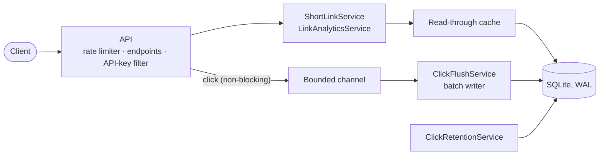

# URL Shortener

A URL shortener built with **C# / .NET 10 (ASP.NET Core Minimal APIs)** and SQLite. It creates
short links (random or custom alias), redirects them, supports link expiry, records
privacy-preserving click analytics, and protects itself from abuse. It is covered by unit,
integration and load tests.

The work was done as three scenarios on one codebase, **greenfield → brownfield → ambiguous**, each
in its own commit, followed by a review-driven hardening pass.

**Contents:** [Quick start](#quick-start) · [API](#api) · [Architecture](#architecture) ·
[The three scenarios](#the-three-scenarios) · [Testing approach](#testing-approach) ·
[Trade-offs](#trade-offs) · [Limitations and next steps](#limitations-and-next-steps) ·
[AI-assisted engineering](#ai-assisted-engineering) · [Project layout](#project-layout)

---

## Quick start

**Prerequisites:** [.NET 10 SDK](https://dotnet.microsoft.com/download/dotnet/10.0)
(`dotnet --version` ≥ 10.0.100). Optional: VS Code with the C# Dev Kit and REST Client extensions.

```bash
dotnet build                                  # warnings are treated as errors
dotnet test                                   # 171 unit + 36 integration tests
dotnet run --project src/UrlShortener.Api     # http://localhost:5260
```

On first run the API creates its SQLite database in `src/UrlShortener.Api/data/` (git-ignored) and
applies schema migrations automatically.

**Try it:** open `src/UrlShortener.Api/UrlShortener.Api.http` in VS Code and click **Send Request**
on each block, or:

```bash
curl -s -X POST http://localhost:5260/api/links -H "Content-Type: application/json" \
  -d '{"url":"https://learn.microsoft.com/dotnet/","customAlias":"dotnet"}'
curl -i http://localhost:5260/dotnet                     # 302 to the target
curl -s http://localhost:5260/api/links/dotnet/stats -H "X-Api-Key: dev-only-admin-key-change-me"
```

### Configuration

Settings come from `appsettings*.json`, environment variables (`Section__Key`) or user-secrets.
The app validates them at startup and refuses to start if any are missing or invalid.

| Key | Default | Notes |
|---|---|---|
| `Shortener:BaseUrl` | `http://localhost:5260` | Public base for short URLs (never taken from the request's Host header) |
| `Shortener:CodeLength` / `MaxExpiryDays` / `BlockedHosts` | `7` / `365` / `[]` | Code length, furthest allowed expiry, domains that may not be shortened |
| `Storage:Provider` / `ConnectionString` | `Sqlite` / `Data Source=data/urlshortener.db` | `InMemory` is also available |
| `Storage:CacheTtlSeconds` | `60` | `0` disables the redirect cache |
| `Analytics:VisitorHashKey` | _(required)_ | **Secret.** Keys the visitor hash |
| `Analytics:RetentionDays` | `395` | Clicks older than this are purged; `0` keeps them forever |
| `RateLimiting:CreatePermitsPerMinute` / `RedirectPermitsPerMinute` / `AdminPermitsPerMinute` | `20` / `300` / `30` | Per client IP |
| `ForwardedHeaders:Enabled` / `KnownProxies` / `KnownNetworks` | `false` / `[]` / `[]` | Turn on behind a load balancer **and list its addresses** |
| `Security:AdminApiKey` | _(none)_ | **Secret.** If unset, admin endpoints return 403 (fail closed) |
| `OTEL_EXPORTER_OTLP_ENDPOINT` | _(unset)_ | When set, metrics are exported over OpenTelemetry (OTLP) |

`appsettings.Development.json` holds clearly labelled dev placeholders for both secrets. Anywhere
else, set real values with `dotnet user-secrets set "Security:AdminApiKey" "<random>"` (run in
`src/UrlShortener.Api`) or environment variables. Secrets never go in source control.

---

## API

Every error is an RFC 9457 `application/problem+json` response. Domain errors carry a stable
`errorCode`. The full contract is the OpenAPI 3.1 document at `/openapi/v1.json` (committed copy:
[docs/openapi.v1.json](docs/openapi.v1.json)).

| Method | Route | Auth | Success | Errors |
|---|---|---|---|---|
| `POST` | `/api/links` body `{ url, customAlias?, expiresAt? }` | none (rate-limited) | `201` + `Location` | `400`, `409 alias_taken`, `413`, `429`, `503` |
| `GET` | `/{code}` | none (rate-limited) | `302` to the target | `404`, `410 link_deleted` / `link_expired`, `429` |
| `GET` | `/api/links/{code}` | none (shares the redirect limit) | `200` metadata | `404`, `410` (destination withheld), `429` |
| `GET` | `/api/links/{code}/stats` | `X-Api-Key` | `200` clicks, unique visitors, per day, referrers, devices | `401`, `403`, `404`, `429` |
| `DELETE` | `/api/links/{code}` | `X-Api-Key` | `204` (soft delete; the code is never reused) | `401`, `403`, `404`, `429` |
| `GET` | `/health` | none | `200 Healthy` | |

Validation error codes: `url_required`, `url_invalid`, `url_too_long`, `url_scheme_not_allowed`,
`url_credentials_not_allowed`, `url_host_not_allowed`, `url_self_reference`, `url_host_blocked`,
`alias_length`, `alias_invalid_characters`, `alias_reserved`, `expiry_in_past`, `expiry_too_far`.

---

## Architecture

Ports and adapters: business rules live in a project with no dependencies, and storage and HTTP
plug into it from the outside.

| Project | Responsibility | Depends on |
|---|---|---|
| `UrlShortener.Core` | Domain model, validation, use cases, interfaces (ports) | nothing (.NET base library only) |
| `UrlShortener.Infrastructure` | SQLite and in-memory stores, cache, click pipeline, retention job, migrations, metrics | Core, Microsoft.Data.Sqlite |
| `UrlShortener.Api` | HTTP: endpoints, API-key auth, rate limiting, error mapping, OpenAPI, telemetry export | Core, Infrastructure |



**Redirect hot path (`GET /{code}`):**
1. A cheap format check rejects junk codes without touching storage.
2. A cached lookup costs zero database reads on a cache hit, one on a miss.
3. Deleted or expired links return 410.
4. The click is dropped into a bounded in-memory channel without waiting.
5. The response is a `302`.

The redirect never writes to the database. A background service writes clicks in batches (up to 500
rows or 1 second, in one transaction), so a slow or failing database delays the stats, never the
redirect.

### Key decisions

| Decision | Instead of | Why |
|---|---|---|
| **302** redirect, not cacheable | 301 | Browsers cache 301s permanently, which would break delete, expiry and analytics |
| Random 7-character Base62 codes from a secure random generator | Sequential IDs, hash of the URL | Not guessable or enumerable. Hashing would also reveal whether someone else shortened the same URL |
| Atomic `INSERT … ON CONFLICT DO NOTHING` | Check, then insert | The database's primary key decides between concurrent requests, so there's no race |
| Soft delete; codes never reused | Hard delete | An old printed link can't be re-pointed at a new, possibly malicious target |
| `Result<T>` for expected failures | Exceptions | Validation errors and conflicts are normal outcomes; mapping them to HTTP happens in one place |
| Raw SQL (ADO.NET) over SQLite | EF Core; SQL Server | Explicit, reviewable SQL with one small dependency and zero setup. Storage can be swapped behind the interfaces |
| Bounded channel + batch writer for clicks | Write each click during the redirect | Keeps writes off the hot path. When overloaded it drops clicks (and counts them) rather than slowing redirects |
| Privacy by design | Storing IPs and user agents | Only a keyed (HMAC) visitor hash, the referrer's host and a device class are stored. Old clicks are purged |
| Versioned migrations (`PRAGMA user_version`) | `CREATE IF NOT EXISTS` only | Supports real schema changes, upgrades existing databases, and refuses a database from a newer build |
| Admin API key, fail closed | Open endpoints; full user accounts | Proportionate for a prototype. Keys are compared in constant time, and guesses are rate-limited |

---

## The three scenarios

### 1. Greenfield: core shortener

**Requirement:** "Build a URL shortener with core APIs."

The brief named capabilities but not behaviour, so each open question got a written default: who can
create links (anyone, rate-limited), who can delete them (admin key), the redirect status (302), the
code format (random), whether the same URL gets the same code (no), whether deleted codes can be
reused (never), and storage (SQLite behind an interface).

**Tasks, in dependency order:**
1. Solution skeleton and quality gates.
2. Domain model and `Result` type.
3. URL and alias validation, and the code generator.
4. `ShortLinkService`.
5. Repository interface with SQLite and in-memory implementations.
6. Cache decorator.
7. Endpoints, error mapping and the API-key filter.
8. Unit and integration tests.

**Validation:**
- A repository **contract test suite** runs unchanged against both stores, including a 20-way race
  for the same code (exactly one request wins).
- Integration tests run the real HTTP pipeline.
- Three defects found by testing were fixed, each with a regression test:
  - malformed JSON returned 500 instead of 400;
  - the create response's timestamp didn't match the stored one;
  - URL parsing behaved differently on Linux and Windows.

### 2. Brownfield: add click analytics

**Requirement:** "The service needs analytics", added to the working Scenario 1 code.

**Impact analysis first:**
- The redirect is the hot path, so it must gain no latency and no new way to fail.
- `ShortLinkService` stays unchanged; analytics lives in a separate `LinkAnalyticsService`.
- The schema change is additive (a new `click_events` table).
- Clicks are recorded at the endpoint, because cache hits never reach the repository.
- Existing API contracts don't change.

**Execution:**
- Raw data is reduced at the point of capture (keyed visitor hash, referrer host, device class).
- Clicks go into a bounded channel with a capacity of 10,000; when full they are dropped and counted.
- A background service writes them in batches and drains the channel on graceful shutdown.
- A new admin endpoint returns the stats.

**Validation:**
- Unit tests cover device classification, hash stability, buffer overflow, drain on shutdown, and a
  failed batch not killing the writer.
- Integration tests check that real redirects are counted correctly and that failed redirects
  aren't counted.
- The full Scenario 1 suite stayed green.
- On the first run on real infrastructure, a .NET 10 start/stop timing issue that could lose
  buffered clicks was found and fixed, with a 100-iteration regression test.

### 3. Ambiguous: "links should expire, and protect the service from abuse"

**Questions a product owner would be asked, and the assumption taken for each:**

| Question | Assumption |
|---|---|
| A fixed TTL, or a date the caller chooses? | An optional absolute `expiresAt` (a client wanting a TTL sends now + TTL) |
| Do links expire by default? | No. Silently changing existing behaviour would break current users |
| What does an expired link return? | `410 Gone` with `link_expired`, which is distinct from never-existed (404) |
| Which kinds of abuse? | Volume (mass creation, scanning), dangerous destinations, oversized requests |
| Rate-limit by what? | Client IP, with separate budgets: create 20/min, redirect 300/min |
| What is a dangerous destination? | Embedded credentials; private, loopback or cloud-metadata IPs in any spelling; internal domains; links back to the shortener; an operator block list |

**Execution:**
- Expiry needed a column added to databases that **already exist**, so a versioned migration runner
  was introduced. It upgrades older databases in place.
- Expiry is checked at read time, so it's exact even for cached links.
- Exploratory testing found that Unicode domains (`bücher.example`) caused every redirect to fail
  with 500. Hosts are now stored in their ASCII (punycode) form.

**Validation:** tests cover:
- 30+ spellings of internal addresses rejected, with boundary addresses allowed;
- expiry valid one minute before, and gone at exactly the expiry time;
- migration upgrade, idempotence, and refusal of a newer schema;
- end-to-end 410 after real expiry;
- 429 with `Retry-After`;
- 413 for an oversized body.

### Follow-up: review-driven hardening

A review of the finished code against its own documentation found four defects:
- the public metadata endpoint bypassed the rate limit and revealed the targets of deleted links;
- a cache race let a deleted link keep redirecting for up to 60 seconds;
- private IPs hidden inside IPv6 addresses got past the destination checks;
- admin endpoints had no brute-force throttling.

Each was fixed with a regression test that was **shown to fail before the fix**. The same pass added:
- opt-in forwarded-headers support for running behind a proxy;
- an OpenAPI document guarded by a contract test;
- metrics with optional OpenTelemetry export;
- a click-retention job;
- a load test.

---

## Testing approach

| Layer | Where | What it proves |
|---|---|---|
| Unit | `tests/UrlShortener.UnitTests` | Business rules in isolation: validation, code generation, expiry boundaries, analytics, buffering |
| Contract | same project (`*ContractTests`) | The SQLite and in-memory stores behave identically, including under concurrency |
| Integration | `tests/UrlShortener.IntegrationTests` | The real HTTP pipeline (routing, auth, rate limiting, error responses) against a throwaway SQLite file |
| API contract | `OpenApiDocumentTests` | The live OpenAPI document matches `docs/openapi.v1.json`, so API changes show up as reviewed diffs |
| Load | `tools/UrlShortener.LoadTest` | Redirect throughput and latency against a running instance |

**Techniques:**
- **Deterministic time.** Time-dependent code takes a `TimeProvider`, so expiry boundaries are tested
  exactly, with no sleeps.
- **Scripted randomness** forces code collisions, to test the retry and give-up paths.
- **Deterministic interleaving.** A test double pauses a read mid-flight to reproduce a race.
- **Every bug fix has a regression test** with a comment explaining what went wrong.

**Quality gates (CI on every push):**
- formatting check (`dotnet format`);
- build with nullable analysis and .NET analyzers, warnings treated as errors;
- all tests;
- a scan for vulnerable packages.

**Performance baseline** (Release build, client and server on one Windows 11 machine, 32 concurrent
clients):
- about **216,000 redirects/s**, at **p99 0.76 ms** with **0 failures**, against a target of
  p99 < 10 ms;
- about 32,000 clicks/s reach SQLite. Above that, clicks are dropped and counted, as designed,
  while redirects stay fast.

To reproduce, start a Release build with rate limiting off
(`$env:RateLimiting__Enabled="false"; dotnet run -c Release --project src/UrlShortener.Api`), then
run `dotnet run -c Release --project tools/UrlShortener.LoadTest`.

**Not covered:**
- load from a separate machine over TLS;
- multi-instance behaviour;
- Kestrel's body limit inside the test host (it was verified manually instead).

---

## Trade-offs

- **SQLite: zero setup and real constraints, but one writer and one node.** Fine for a prototype
  and modest traffic. To scale out, add a Postgres or SQL Server adapter; Core doesn't change.
- **In-process cache and rate limiter.** With N instances, a deleted link can keep redirecting on
  other instances for up to 60 seconds, and the effective rate limit becomes N times the configured
  value. The fix is Redis-backed equivalents.
- **Analytics are best-effort.** Clicks can be dropped under overload or lost in a hard crash,
  because redirect speed comes first. Billing-grade counts would need a durable queue.
- **Fixed-window rate limiting** is simple, but allows bursts of up to twice the limit at window
  boundaries. A sliding window or token bucket can be swapped in.
- **No URL deduplication.** Every create gets a new code, which avoids leaking information between
  users at the cost of some storage.
- **No DNS resolution** when checking destinations. Resolving names would make the shortener itself
  an attack vector (SSRF, DNS rebinding), so names that resolve to private IPs aren't caught.

---

## Limitations and next steps

- No user accounts or link ownership, so delete and stats are admin-only.
- No malware or phishing reputation feed; only an operator-managed block list.
- Unicode look-alike domains are shown in punycode but not flagged.
- Visitor-hash key rotation is manual.
- Behind a load balancer, `ForwardedHeaders` must list the balancer's addresses, or every client
  shares one rate-limit bucket. It's off by default, and startup fails if it's enabled without any.
- Metrics are exported, but no dashboards or alerts are defined.

**Assumptions:**
- anonymous link creation is acceptable when rate-limited;
- one admin role is enough;
- analytics days are UTC days.

---

## AI-assisted engineering

As the assignment requires, this project was built by **Matthew Lee** with **Claude (Anthropic)** as
an AI pair programmer. I led the work: I framed each task, reviewed and ran every output on my own
machine, and approved every commit. Claude assisted with implementation, debugging, tests, review
and documentation, and AI-assisted commits carry a `Co-Authored-By: Claude` trailer.

**How tasks were framed.** Every task had four parts:
- **intent**;
- **constraints**, e.g. "the redirect must not gain a database write";
- **acceptance criteria**, e.g. "buffer is bounded; overflow is counted; shutdown drains";
- **technical context**.

The working loop was: generate → build (warnings as errors) → test → probe by hand → fix → add a
regression test → commit.

**Selected decisions** (generated / edited / rejected):

| Item | Outcome | Reason |
|---|---|---|
| EF Core for persistence | Rejected | Too heavy for a few tables; explicit SQL keeps the atomic insert reviewable |
| Check-then-insert for aliases | Rejected | Race condition; replaced by an atomic insert plus a concurrency test |
| 301 redirects | Rejected | Browser caching would defeat delete, expiry and analytics |
| Writing each click during the redirect | Rejected | Adds a write and a failure mode to the hot path |
| DNS lookups to detect private targets | Rejected | Would open the shortener to SSRF and DNS rebinding |
| Admin account lockout | Rejected | With one shared key, an attacker could lock out the operator |
| Swagger UI | Rejected | An extra package; the OpenAPI JSON and `.http` file cover review and manual testing |
| Reading options eagerly at startup | Edited | Ignored test configuration overrides; now read lazily |
| `customAlias` marked required in OpenAPI | Edited | The generated schema exposed it; fixed with a default value |

**Defects caught by verification, not by the AI.** Each has a regression test:
- **During development:** malformed JSON returned 500; timestamps didn't match; URL parsing differed
  by OS; Unicode hosts broke redirects.
- **On first real run:** a vulnerable SQLite package (fixed by upgrading, not by suppressing the
  warning); a .NET 10 shutdown race that lost clicks.
- **Code review:** the metadata endpoint's rate-limit bypass and target leak; the cache/delete race;
  IPv4 hidden in IPv6; unthrottled admin endpoints; an off-by-N bug in the AI's own in-memory purge,
  caught by the contract tests; formatting drift, now enforced in CI.

**Secure AI usage:**
- no secrets or proprietary code were shared with the AI;
- generated code was treated as untrusted until it passed the gates above;
- every runtime dependency is pinned and justified.

**High-impact changes requiring engineer sign-off:**

- [ ] Schema migrations 1–4 (irreversible on production data)
- [ ] Destination safety rules (a security boundary; false positives block real users)
- [ ] Admin API-key filter and admin rate limit (authentication for destructive operations)
- [ ] Rate-limit values: 20 creates, 300 redirects, 30 admin calls per IP per minute (can affect users behind NAT)
- [ ] Analytics data model and 395-day retention (privacy; permanent deletion)
- [ ] Forwarded-headers trusted-proxy list (a wrong list allows IP spoofing)
- [ ] Public contract change: deleted links return 410 from the metadata endpoint
- [ ] Scenario 3 product assumptions (no default expiry, 410 semantics, 365-day maximum)

---

## Project layout

```
src/
  UrlShortener.Core/             Domain, validation, use cases, interfaces (no dependencies)
  UrlShortener.Infrastructure/   Persistence/, Caching/, Analytics/, Observability/
  UrlShortener.Api/              Endpoints/, Contracts/, Security/, Errors/, Configuration/,
                                 UrlShortener.Api.http (ready-made requests)
tests/
  UrlShortener.UnitTests/        Rules, services, repository contract suites
  UrlShortener.IntegrationTests/ Full HTTP pipeline, OpenAPI contract test
tools/
  UrlShortener.LoadTest/         Redirect load generator
docs/openapi.v1.json             Committed API contract
.github/workflows/ci.yml         Format check, build, test, vulnerability scan
```
