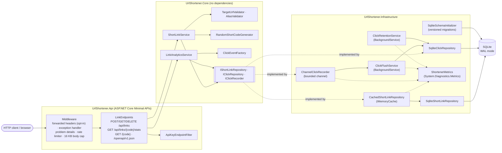
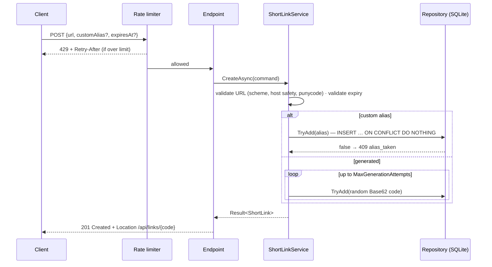

# Architecture Overview

## 1. Components



| Project | Responsibility | Depends on |
|---|---|---|
| **Core** | Domain model, business rules, validation, use-case services, ports (interfaces) | nothing (BCL only) |
| **Infrastructure** | SQLite + in-memory adapters, cache decorator, analytics pipeline, migrations, DI wiring | Core, ASP.NET shared framework, Microsoft.Data.Sqlite |
| **Api** | HTTP surface: routing, binding, auth filter, rate limiting, forwarded headers, error mapping, OpenAPI, telemetry export, configuration | Core, Infrastructure, Microsoft.AspNetCore.OpenApi, OpenTelemetry (OTLP) |

Dependencies point inwards (ports-and-adapters). Business rules can be unit tested without HTTP or a
database, and storage can be swapped (SQL Server, Postgres, Redis) by adding an adapter, without
touching Core.

## 2. Request flows

### Create: `POST /api/links`



### Redirect: `GET /{code}` (hot path)

```mermaid
sequenceDiagram
    participant C as Client
    participant E as Endpoint
    participant S as ShortLinkService
    participant K as Cache
    participant R as SQLite
    participant Q as Click channel
    participant F as ClickFlushService
    C->>E: GET /{code}
    E->>E: syntactic check (cheap 404 for junk)
    E->>S: ResolveAsync(code)
    S->>K: Get(code)
    K-->>S: hit, or miss → R
    S->>S: deleted? → 410 · expired? → 410
    E->>Q: TryRecord(click)  (non-blocking; drop if full)
    E-->>C: 302 Location: target
    Note over Q,F: asynchronously
    F->>Q: read batch (≤500 or ≤1 s)
    F->>R: INSERT batch in one transaction
```

The redirect does **at most one indexed primary-key read** (zero on a cache hit) and **no writes**.
Analytics is decoupled through a bounded channel, so a slow or failing database delays the stats,
not the redirect.

## 3. Key decisions

| Decision | Alternatives | Why |
|---|---|---|
| Minimal APIs, not MVC controllers | Controllers | Small surface; less ceremony; endpoint filters cover the cross-cutting needs. |
| `Result<T>`/`DomainError` for expected failures | Exceptions | Validation/conflict/not-found are normal outcomes. Exceptions stay for bugs, and the HTTP mapping lives in one place (`ResultMapping`). |
| Raw ADO.NET (Microsoft.Data.Sqlite) | EF Core, Dapper | Four tables' worth of SQL. Explicit SQL makes the atomic `ON CONFLICT` insert and the aggregate queries visible and reviewable; one small dependency. |
| SQLite | SQL Server, Postgres | Zero-setup for reviewers, real constraints and transactions. Limits are listed in [RISKS.md](RISKS.md). |
| Atomic insert-or-fail for codes | Check-then-insert | Check-then-insert races under concurrency. The primary key arbitrates. Covered by a 20-way concurrency test. |
| Random CSPRNG codes | Sequential/hashids, URL hash | Not enumerable or guessable. Hash-of-URL would dedupe across users and leak who shortened what. |
| Soft delete; codes never reused | Hard delete | Stops a circulating link being re-pointed to a malicious target. |
| 302 redirect + `Cache-Control: private, max-age=0` | 301/308 | Permanent redirects are cached forever by browsers, which would defeat delete, expiry and analytics. |
| Read-through cache, no negative caching, invalidate on delete | No cache / distributed cache | Targets are immutable, so caching is safe; skipping negative caching keeps newly created aliases visible at once. Per-process trade-off documented. |
| Expiry checked at read time | Background purge job | Exact to the millisecond, even for cached entries; no scheduler needed. |
| Bounded channel + batch writer for clicks | Synchronous insert per redirect; external queue | Keeps writes off the hot path with no new infrastructure. Dropping on overflow puts redirects ahead of analytics completeness. |
| Privacy-preserving analytics (HMAC visitor hash, referrer host only, device class only) | Store IP/UA/referrer verbatim | Data minimisation: unique-visitor counts without holding personal data. |
| Versioned migrations via `PRAGMA user_version` | `CREATE IF NOT EXISTS` only; EF migrations | Supports real `ALTER`s (Scenario 3), upgrades existing databases, refuses to run against a newer schema. |
| Options validated on start | Validate lazily | Misconfiguration (missing secrets, bad base URL) fails the deploy, not the first request. |
| Admin API key, fail closed | Open endpoints; full identity | Proportionate for a prototype. Missing key ⇒ 403, never open. SHA-256 digests compared in constant time; per-IP admin rate limit applied before the key check. |
| Public metadata shares the redirect rate limit; deleted links → 410 | Admin-only metadata | A public "where does this go?" preview is useful against phishing, but it must not be an unthrottled enumeration oracle or advertise taken-down targets. |
| Forwarded headers opt-in, explicit proxy allow-list | Always on; trust any proxy | Bare Kestrel needs none; trusting X-Forwarded-For from anyone lets clients choose their own rate-limit bucket. |
| Metrics on BCL `Meter`; OTLP export only when configured | Prometheus endpoint; always-on SDK | No dependency in Infrastructure; no export loop without a collector; the Prometheus exporter is still prerelease. |
| Retention purge in bounded batches + time index | Unbounded `DELETE`; id-range delete | Keeps SQLite's single write lock short so click flushing never stalls; ids aren't strictly time-ordered. |
| OpenAPI snapshot test | Generated doc only | Contract changes appear as reviewed diffs instead of slipping through. |

## 4. Cross-cutting concerns

- **Errors:** every non-2xx response is RFC 9457 `application/problem+json`, with a stable
  machine-readable `errorCode` for domain errors (`alias_taken`, `url_host_not_allowed`, …).
  Malformed JSON gets a 400, not a 500 (`BadRequestExceptionHandler`).
- **Configuration:** `Shortener`, `Storage`, `Analytics`, `RateLimiting`, `ForwardedHeaders`, `Security` sections.
  Secrets (`Security:AdminApiKey`, `Analytics:VisitorHashKey`) come from user-secrets or environment
  variables. The only values in source control are dev placeholders, in `appsettings.Development.json`.
- **Observability:** `/health`, ASP.NET Core structured logging, source-generated log messages for
  analytics failures, and the `UrlShortener` meter (cache hit/miss, clicks dropped / persisted /
  failed / purged, buffer depth) next to ASP.NET Core's `http.server.request.duration`. Exported over
  OTLP when `OTEL_EXPORTER_OTLP_ENDPOINT` is set.
- **Quality gates (build-time):** nullable reference types, `AnalysisLevel=latest-recommended`,
  `TreatWarningsAsErrors`, code style enforced in build, CI workflow (`.github/workflows/ci.yml`)
  running build, tests and a vulnerable-package scan.
